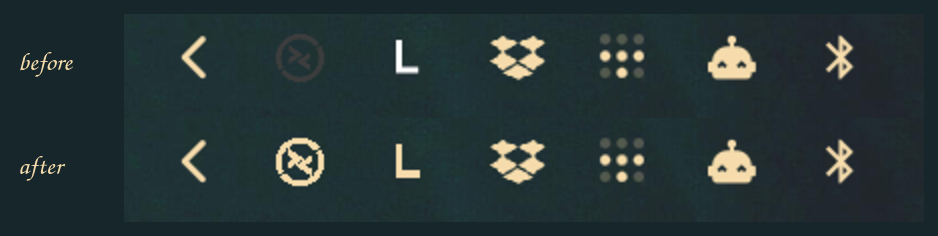

# omarchy-tray-recolor

Make stubborn tray icons follow your Omarchy theme.

The Omarchy bar recolors a tray icon only when the icon's *name* ends in the
freedesktop `-symbolic` suffix. Plenty of apps ship a perfectly good monochrome
glyph that misses that convention, so the bar draws it with whatever fill it
happens to carry — and it sits there looking nothing like its neighbours.

Two real examples:

| App | Advertises | Drawn as |
|---|---|---|
| Remmina | `org.remmina.Remmina-status` | Yaru bakes `#3d3d3d` into its panel icon — near-invisible on a dark bar |
| lerd | `/tmp/systray_XXXXXX` | a white PNG, written to a fresh temp path every run |

Neither name ends in `-symbolic`, so neither gets recolored.

This patches the tray to pour the **bar foreground through the glyph's own alpha
channel**, which is already the shape you want. No replacement icons, nothing
baked in, and it tracks theme changes live — switch themes and the icons follow
in the same frame, with no restart.



Remmina's ring goes from the icon theme's near-invisible grey to the bar
foreground; lerd's `L` from stark white to the same cream as its neighbours.
Nothing else on the bar changes.

## Requirements

- Omarchy with the Quickshell bar
- `jq`, `python3`

## Install

```sh
git clone https://github.com/tdhftw/omarchy-tray-recolor
cd omarchy-tray-recolor

./install.sh --list          # see what is on your bar
```

`--list` prints a suggested name for each item:

```
SUGGESTED      ID                       TITLE              ICON
lerd           systray                  lerd-tray          /tmp/systray_tSjzvH
dropbox        dropbox-client-215916    dropbox            dropboxstatus-idle
mullvad        Mullvad VPN_status_icon_1 -                 -   (pixmap — check it is monochrome before adding)
remmina        remmina-icon             Remmina            org.remmina.Remmina-status
```

Put the ones you want in `~/.config/omarchy/tray-recolor.conf`, one per line
(see `tray-recolor.conf.example`), then:

```sh
./install.sh
```

Or skip the config file entirely:

```sh
./install.sh --items remmina,lerd
```

Re-run any time to pick up an edited list. To remove it:

```sh
./install.sh --revert
```

## Only list monochrome icons

**This is the one thing to get right.** A full-color status icon carries meaning
in its color — Mullvad's padlock is `#D0021B` when the VPN is disconnected.
Recoloring it flattens it to a foreground-colored silhouette and throws that
distinction away. The tool will happily do it if you ask; don't ask.

A useful sanity check before adding something:

```sh
magick "$ICON" -format '%c' histogram:info:- | sort -rn | head
```

Two entries (transparent + one color) is a safe monochrome glyph. A spread of
hues is not.

Watch out for one more trap: an icon can *look* monochrome while its alpha
channel is a solid block, because the glyph is drawn in negative space. Remmina's
own `hicolor` icon is exactly this — a filled disc with the logo cut out of it.
Recoloring that yields a featureless blob. Check the alpha, not the picture:

```sh
magick "$ICON" -alpha extract -resize 200% alpha.png
```

## How names are matched

A name is a lowercased substring test against a tray item's **id, title and
tooltip** — never its icon name. That matters: lerd writes a fresh
`/tmp/systray_XXXXXX` every run, and apps like Dropbox carry a pid in their id.
Matching the item rather than the icon survives both.

So `remmina` matches the item whose id is `remmina-icon`, and `lerd` matches the
one whose title is `lerd-tray`. Prefer the shortest fragment unique to the app.

## How it works

Anchored surgery on your local clone of `omarchy.tray` — not a frozen fork, so
re-running after an `omarchy update` re-applies to the new upstream code. Every
anchor is required: a miss aborts without touching the file rather than leaving
a half-patched tray. `--revert` restores the files byte-for-byte.

The packaged tray under `/usr/share/omarchy` is never touched. If you have no
clone yet, `install.sh` makes one with `omarchy plugin clone omarchy.tray`.

Rendering is a `MultiEffect` masking a solid `bar.foreground` rectangle through
the icon's alpha. It deliberately does **not** use colorization, which preserves
luminance and would dim the silhouette by the foreground's own brightness.

It also deliberately touches only the icon *rendering*, never `classifyItem()`,
so a recolored item keeps its normal pinned / drawer / hidden placement.

## Playing well with other patches

The tray is a shared file, and more than one plugin may want a piece of it. This
patch picks its shape automatically:

- **standalone** — a stock tray. Installs the silhouette machinery itself.
- **layered** — a tray already carrying
  [dropbox-extended](https://github.com/tdhftw/omarchy-dropbox-extended)'s
  patch, which installs equivalent machinery. Reuses it and adds only this
  predicate, so the two coexist.

If you use both, **apply dropbox-extended's tray patch first**, then this one.
Its patch anchors on stock code and will refuse to apply on top of this one.

Anything that rebuilds the clone from the packaged tray — an `omarchy update`
followed by dropbox-extended's `tray/install.sh --refresh` — drops this patch.
Re-run `./install.sh` afterwards; it is a no-op if already applied.

## License

MIT
